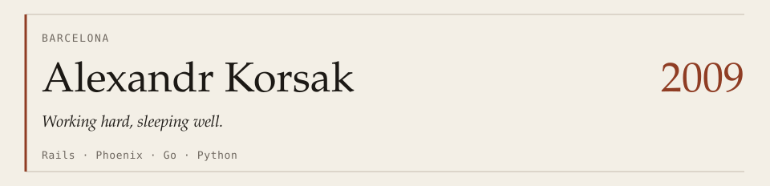

<picture>
  <source media="(prefers-color-scheme: dark)" srcset="./assets/masthead-dark.svg">
  
</picture>

Building in Barcelona since 2009. The libraries that are still installed, and the work in progress, live on this account.

## Libraries

Maintained, and still installed in other people's apps.

| Library | What it does |
| --- | --- |
| [devise_masquerade](https://github.com/oivoodoo/devise_masquerade) | Login-as for Devise, so an admin can enter an account without the password. |
| [phoenix_lens](https://github.com/oivoodoo/phoenix_lens) | SQL notebook mounted in a Phoenix app. Saved questions, dashboards, PII masked on every result. |
| [pghero-elixir](https://github.com/oivoodoo/pghero-elixir) | Postgres performance for Phoenix, also runnable as Docker. An Elixir port of PgHero. |
| [phoenix_healthy](https://github.com/oivoodoo/phoenix_healthy) | Liveness and readiness probes for Phoenix and Plug. |
| [redis_poolex](https://github.com/oivoodoo/redis_poolex) | Redis connection pool built on poolboy. |

Earlier, and left in place: [exfacebook](https://github.com/oivoodoo/exfacebook), [angular-image-spinner](https://github.com/oivoodoo/angular-image-spinner), [backbone-queues](https://github.com/oivoodoo/backbone-queues).

## Now

Elixir and Go when a hot path has to hold. Python for retrieval, eval, and fine-tunes.

## Elsewhere

[Blog](https://dev.to/oivoodoo) · [YouTube](https://www.youtube.com/@oivoodoo) · [X](https://x.com/oivoodoo)
